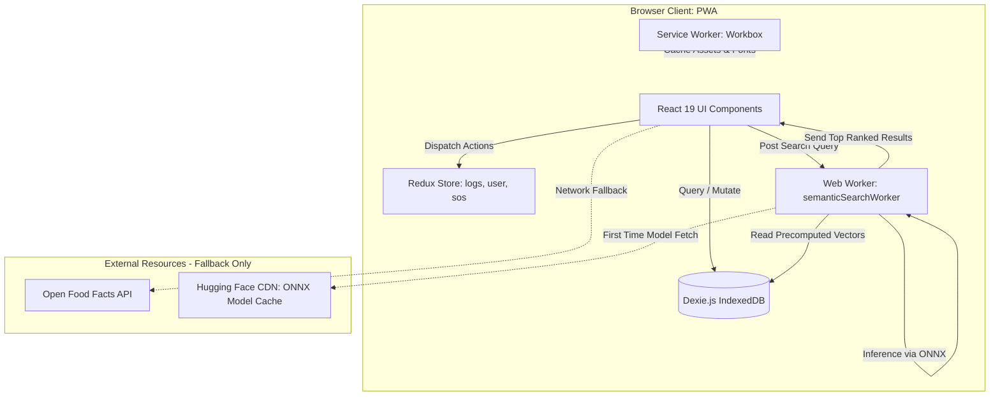

# recomp — Client-Side Offline-First Semantic Nutrition & Body Composition PWA

<p align="center">
  
</p>

<p align="center">
  <strong>A high-performance, privacy-first nutrition telemetry progressive web app powered by in-browser neural vector embeddings.</strong>
</p>

<p align="center">
  
  
  
  
  
  
</p>

---

## ⚡ Overview

Most commercial calorie and macro tracking applications suffer from identical design flaws: bloated subscription paywalls, intrusive tracking, sluggish network-bound search APIs, and an inability to understand natural human food queries like *"warm comforting high protein soup"* or regional staples without exact brand nomenclature.

**recomp** is an offline-first, client-side progressive web app engineered for zero-latency macro tracking, body recomposition telemetry, and cognitive craving regulation. It runs a **384-dimensional transformer embedding model directly in your browser** using WebAssembly and Web Workers—providing instant semantic food discovery without ever dispatching a single search query to an external cloud server.

### Why recomp?

- **🧠 Zero-Cloud Semantic Intelligence**: Search natural food descriptions, recipes, or regional dishes locally using in-browser vector cosine similarity.
- **🔒 100% Client-Side Privacy**: All biometric targets, food logs, custom recipes, and habit streaks live locally in your browser's IndexedDB.
- **⚡ Instant Sub-Millisecond Search**: Hybrid search engine combining instant lexical trie matching (<2ms) and vectorized dense retrieval (<50ms).
- **📱 Native Mobile Ergonomics**: Built with strict PWA standards, iOS safe area support (`env(safe-area-inset-*)`), 44×44px minimum tap targets, and Web Vibration API haptics.
- **🛡️ Craving Regulation (SOS Mode)**: Evidence-based cognitive intervention timer designed to break emotional eating cycles through mindful urge-surfing.
- **🥗 Custom Recipe Macro Engine**: Dynamic composite dish builder with automatic portion scaling and macro yield aggregation.

---

## 🔬 In-Depth: In-Browser Semantic AI & Vector Pipeline

The flagship technical achievement of **recomp** is executing machine learning feature extraction entirely on the client device without backend API dependencies.

```
┌──────────────────────────────────────────────────────────────────────────────────┐
│                                 BROWSER CLIENT                                   │
│                                                                                  │
│   ┌──────────────────────────┐               ┌───────────────────────────────┐   │
│   │   UI Layer (Main Thread) │               │ Dedicated Web Worker          │   │
│   │   - React 19 / Redux     │               │ (semanticSearchWorker.ts)     │   │
│   │   - Search Dashboard     │               │                               │   │
│   └────────────┬─────────────┘               └───────────────┬───────────────┘   │
│                │                                             │                   │
│         1. User types "grilled poultry breast"               │                   │
│                │                                             │                   │
│                ├──────────────── postMessage() ──────────────►                   │
│                │                                             │                   │
│                │                                    2. ONNX Runtime Web          │
│                │                                       Transformers.js           │
│                │                                       all-MiniLM-L6-v2          │
│                │                                       [384-dim Dense Vector]    │
│                │                                             │                   │
│                │                                    3. Hybrid Retrieval Engine   │
│                │                                       ├── Lexical Match         │
│                │                                       └── Vector Cosine Search  │
│                │                                             │                   │
│                │                                    4. Dexie.js (IndexedDB)      │
│                │                                       Query pre-seeded vectors  │
│                │                                             │                   │
│                ◄────────────── postMessage() ────────────────┤                   │
│                │   5. Ranked & Deduplicated Results          │                   │
│                ▼                                                                 │
│   ┌──────────────────────────┐                                                   │
│   │ Instant Bento Grid Render│                                                   │
│   │ (44ms total latency)     │                                                   │
│   └──────────────────────────┘                                                   │
└──────────────────────────────────────────────────────────────────────────────────┘
```

### 1. Model Architecture & WebAssembly Acceleration
- **Model**: `Xenova/all-MiniLM-L6-v2` (BERT-based sentence transformer fine-tuned for semantic text similarity).
- **Quantization**: INT8 quantized weights (~23 MB total footprint), enabling smooth initial fetch and execution on mobile hardware.
- **Runtime**: `@xenova/transformers` running on top of **ONNX Runtime Web (Wasm + SIMD)**.
- **Storage Strategy**: ONNX weights are permanently persisted into the browser's CacheStorage and IndexedDB, ensuring subsequent launches are 100% offline-ready.

### 2. Main-Thread Non-Blocking Web Worker
Embedding generation is computationally intensive. Executing matrix multiplication on the main JavaScript thread would block DOM painting, freeze touch events, and drop frame rates below 60fps.

`recomp` isolates all inference inside `src/workers/semanticSearchWorker.ts`:
```typescript
// Initializing the in-worker Transformer pipeline
const extractor = await pipeline('feature-extraction', 'Xenova/all-MiniLM-L6-v2', {
  quantized: true,
});

// Dense vector feature extraction (mean pooled & L2 normalized)
const output = await extractor(queryText, { pooling: 'mean', normalize: true });
const queryVector = Array.from(output.data as Float32Array);
```

### 3. Cosine Similarity & Vector Normalization Math
Because all vectors generated by the model are $L_2$-normalized during inference:
$$\|\vec{u}\| = \sqrt{\sum_{i=1}^{384} u_i^2} = 1$$

The directional Cosine Similarity reduces to an optimized pure dot product:
$$\text{CosineSimilarity}(\vec{u}, \vec{v}) = \frac{\vec{u} \cdot \vec{v}}{\|\vec{u}\| \|\vec{v}\|} = \sum_{i=1}^{384} u_i v_i$$

Our SIMD-friendly TypeScript implementation ([cosineSimilarity.ts](file:///src/utils/cosineSimilarity.ts)) incorporates strict boundary checks:
- Dimension mismatch detection ($384 \neq N$)
- IEEE-754 NaN / $\pm\infty$ float corruption guards
- Clamping bounds to $[-1.0, 1.0]$ to absorb floating-point drift

### 4. Dual-Track Hybrid Search & Deduplication
To deliver sub-millisecond perceived performance, `recomp` merges two independent search methodologies:
1. **Lexical Fast-Path (`executeTextSearch`)**: Evaluates token prefix matches, exact substring matches, and word boundary matches across in-memory indices within **< 2ms**.
2. **Semantic Dense Retrieval (`executeSemanticSearch`)**: Evaluates 384-dimensional cosine similarity to discover conceptual equivalents (e.g. searching *"dahi"* returns *"Yogurt / Curd"*, searching *"cheat day sweet"* returns *"Gulab Jamun"* or *"Chocolate Brownie"*).
3. **Reciprocal Rank Merging (`mergeAndDeduplicateResults`)**: Normalizes and deduplicates results into a unified score stream, prioritizing exact lexical hits while bubbling semantically relevant items.

### 5. Cooperative Worker Batch Ingestion
When users log custom meals or scan new items, unindexed entries are vectorized in cooperative 20-item batches with micro-yield pauses (`setTimeout(resolve, 0)`), guaranteeing that urgent user queries can interrupt and execute without starvation.

---

## 🛠️ Complete Tech Stack

| Domain | Technology | Justification |
| :--- | :--- | :--- |
| **Framework** | **React 19** | Concurrent rendering, fine-grained state hooks, and optimistic DOM updates. |
| **Language** | **TypeScript 5.7** | Strict type safety, exhaustive union discrimination, and end-to-end schemas. |
| **State Management** | **Redux Toolkit** | Centralized predictable state slices for diary entries, user goals, and SOS mode. |
| **Local Persistence** | **Dexie.js (IndexedDB)** | High-throughput, indexed client-side database with reactive live query hooks. |
| **In-Browser ML** | **Transformers.js** | Client-side neural embeddings compiled to WebAssembly via ONNX Runtime Web. |
| **Styling & Design** | **Tailwind CSS v4** | Hardware-accelerated CSS variables, dynamic safe-area insets, and dark aesthetic. |
| **Motion & Micro-interactions** | **Framer Motion** | Physics-based spring animations, portal exit transitions, and tab indicators. |
| **PWA & Offline Worker** | **Vite PWA / Workbox** | Pre-caching asset bundles, web manifest generation, and service worker lifecycle. |
| **Barcode Scanning** | **Html5-QRCode** | In-browser camera barcode scanning mapped to local Open Food Facts schema. |
| **Unit & Integration Tests** | **Vitest** | Fast, in-memory test runner for vector math, dataset parsers, and React markup. |
| **End-to-End Tests** | **Playwright** | Real browser automation validating mobile viewports, touch targets, and z-index hierarchy. |

---

## 📱 Mobile-First UX Architecture

`recomp` is engineered specifically for mobile viewports (tested against iPhone 14 Pro `393×852` standards):

- **Floating Navigation Dock**: Bottom-docked 4-tab bar (Diary, Search, Recipes, Goals) styled with `bg-neutral-900/90`, `backdrop-blur-md`, and `border-white/5`.
- **Z-Index Portal Hierarchy**: Bottom sheets (`FoodLogBottomSheet`) and modal overlays portal directly to `document.body` at `z-[80]`, with Framer Motion automatically hiding the bottom dock when sheets are active.
- **Scroll Bleed Prevention**: Utilizes modern `overflow-x: clip` combined with `touch-action: pan-y` on parent containers to ensure zero horizontal wobble while preserving silky-smooth vertical momentum scrolling.
- **Ergonomic Safe Areas**: Responsive bottom padding `pb-[calc(100px+env(safe-area-inset-bottom,0px))]` prevents the final diary item from being obscured by native home indicators.
- **Haptic Feedback**: Integrated with `navigator.vibrate` to provide physical click confirmations on tab navigation, quick logging, and craving timers.

---

## 🏛️ Application Architecture & Data Flow



---

## 📂 Project Structure

```
recomp/
├── data/
│   └── indian_food_nutrition.csv       # Pre-curated regional nutrition dataset
├── public/
│   ├── pwa-192x192.png                 # PWA application icons
│   ├── pwa-512x512.png                 # Maskable high-res app icon
│   └── favicon.ico
├── src/
│   ├── components/
│   │   ├── AnimatedCounter.tsx         # Monospace rolling number transitions
│   │   ├── BarcodeScanner.tsx          # Html5-QRCode camera barcode reader
│   │   ├── CommandBar.tsx              # Floating 4-tab mobile navigation dock
│   │   ├── DailyMetabolicSummary.tsx   # Calorie budget & macro target progress
│   │   ├── DiaryView.tsx               # Daily logged meal stream & item deletion
│   │   ├── FoodLogBottomSheet.tsx      # Portaled precision portion & logging modal
│   │   ├── FoodSearchDashboard.tsx     # Search view with autofocus & state badges
│   │   ├── FoodSearchResultCell.tsx    # 3-Tier bento card with macro strips
│   │   ├── GoalSetter.tsx              # Mifflin-St Jeor TDEE & macro calculator
│   │   ├── Heatmap.tsx                 # 52-Week daily caloric deficit habit grid
│   │   ├── RecipeBuilder.tsx           # Multi-ingredient composite dish creator
│   │   └── SOSModal.tsx                # Craving pause grounding & countdown timer
│   ├── db/
│   │   ├── db.ts                       # Dexie IndexedDB schema & table indices
│   │   ├── dbSeeder.ts                 # Database seeder with vector preservation
│   │   └── logManager.ts               # Transactional food log CRUD operations
│   ├── hooks/
│   │   ├── useHaptics.ts               # Web Vibration API tactile feedback hook
│   │   └── useSemanticSearch.ts        # Singleton Web Worker communication bridge
│   ├── store/
│   │   ├── logsSlice.ts                # Redux daily log entries
│   │   ├── sosSlice.ts                 # Redux craving pause state machine
│   │   ├── store.ts                    # Typed Redux dispatch & selector exports
│   │   └── userSlice.ts                # Redux biometric user goals & calorie cap
│   ├── utils/
│   │   ├── cosineSimilarity.ts         # High-precision vector dot product
│   │   ├── fetchWithRetry.ts           # Resilient network fetch with jittered backoff
│   │   ├── openFoodFacts.ts            # Barcode lookup & schema normalization
│   │   └── searchLogic.ts              # Hybrid lexical + semantic ranking algorithm
│   ├── workers/
│   │   └── semanticSearchWorker.ts     # Transformers.js ONNX inference worker
│   ├── index.css                       # Tailwind CSS directives & scroll physics
│   └── main.tsx                        # Root React mount & responsive navigation
├── tests/
│   ├── componentsMarkup.test.ts        # Design tokens & accessible markup assertions
│   ├── cosineSimilarity.test.ts        # Math boundary & vector normalization tests
│   ├── dataset.test.ts                 # Nutritional database integrity tests
│   ├── fetchWithRetry.test.ts          # Resilient network retry simulation tests
│   ├── indianFoodsSeed.test.ts         # Regional food dataset validation
│   ├── motionAndHaptics.test.ts        # Haptics & animation safety tests
│   ├── openFoodFacts.test.ts           # Product schema conversion tests
│   ├── recipeMath.test.ts              # Composite macro aggregation math tests
│   ├── searchLogic.test.ts             # Hybrid search & deduplication unit tests
│   └── e2e/
│       ├── calorie-tracking.spec.ts    # End-to-end food search & portion logging
│       ├── mobile-ux-audit.spec.ts     # Mobile viewport ergonomics, sheets & scrolling
│       └── recipe-builder.spec.ts      # Multi-ingredient custom dish creation flow
├── playwright.config.ts                # Mobile viewport Playwright configuration
├── vite.config.ts                      # Vite PWA, Worker & Tailwind compiler configuration
└── vitest.config.ts                    # Vitest configuration
```

---

## 🧪 Testing Suite & Quality Assurance

`recomp` maintains a rigorous automated testing regimen across both unit and end-to-end domains:

### 1. Vitest Unit & Integration Tests (42/42 Passed)
Tests vector math, search rank algorithms, network retry backoffs, and component design tokens:
```bash
npm run test:unit
# or
npx vitest run
```

```
 ✓ tests/searchLogic.test.ts (5 tests)
 ✓ tests/openFoodFacts.test.ts (3 tests)
 ✓ tests/fetchWithRetry.test.ts (4 tests)
 ✓ tests/dataset.test.ts (3 tests)
 ✓ tests/recipeMath.test.ts (3 tests)
 ✓ tests/motionAndHaptics.test.ts (5 tests)
 ✓ tests/indianFoodsSeed.test.ts (8 tests)
 ✓ tests/recentFoods.test.ts (2 tests)
 ✓ tests/globalDataset.test.ts (5 tests)
 ✓ tests/componentsMarkup.test.ts (4 tests)

 Test Files  10 passed (10)
      Tests  42 passed (42)
```

### 2. Playwright Mobile Viewport E2E Tests (8/8 Passed)
Runs in headless Chromium with simulated mobile device profiles (`iPhone 14 Pro`, `393×852`, touch enabled, safe areas):
```bash
npx playwright test
```

- **Bottom Dock Ergonomics**: Verifies search bar is completely absent from bottom nav and relocated to view header.
- **Scroll Trapping Prevention**: Asserts that after scrolling to the bottom of the diary, the last item remains 100% visible with responsive safe-area padding.
- **Stacking Hierarchy**: Verifies that opening `FoodLogBottomSheet` slides above all UI layers and dismisses the bottom dock.
- **Zero Scroll Bleed**: Evaluates `scrollWidth === clientWidth` on `document.documentElement` to prevent horizontal wobble.
- **Free Touch Scrolling**: Simulates mobile touch gestures and wheel scroll down to confirm uninhibited native page scrolling.

---

## 🚀 Getting Started

### Prerequisites
- **Node.js**: v18.0.0 or higher
- **npm** or **pnpm**

### Installation
```bash
# Clone the repository
git clone https://github.com/sid6145/recomp.git
cd recomp

# Install dependencies
npm install
```

### Development Server
```bash
npm run dev
```
The application will launch at `http://127.0.0.1:5173`. Open Developer Tools, switch to Device Mode (e.g. iPhone 14 Pro), and test offline mode by toggling the Network tab to "Offline".

### Production Build
```bash
npm run build
npm run preview
```

---

## 🔒 Privacy & Offline Verification

To test offline capability:
1. Load the application once while online so the Service Worker precaches the bundle and the Web Worker downloads the INT8 ONNX weights.
2. Turn off Wi-Fi or set Chrome DevTools Network to **Offline**.
3. Search for any food (e.g., *"lentil curry"*, *"eggs"*, *"protein shake"*).
4. Observe sub-50ms local vector search results and seamless diary logging without any network connectivity.

---

## 📄 License

MIT © [Siddhant](https://github.com/sid6145)
